# Codigos PlantUML diferenciados

## 1. Caso de uso - Mapa: consulta dentro del terminal

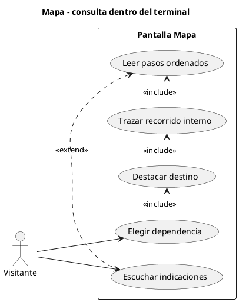

## 2. Caso de uso - MapaR: recorrido urbano

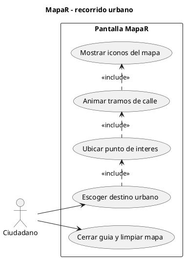

## 3. Caso de uso - MapaConf: autor de rutas internas

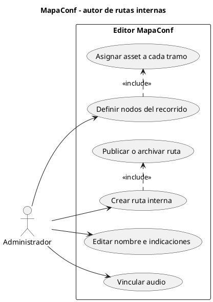

## 4. Caso de uso - MapaRConf: compositor de mapa urbano

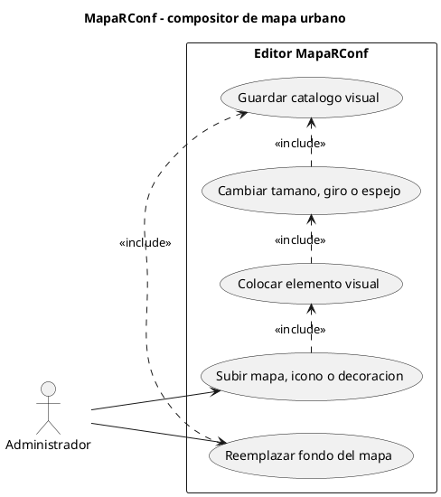

## 5. Diagrama de componentes - entrega de un recorrido

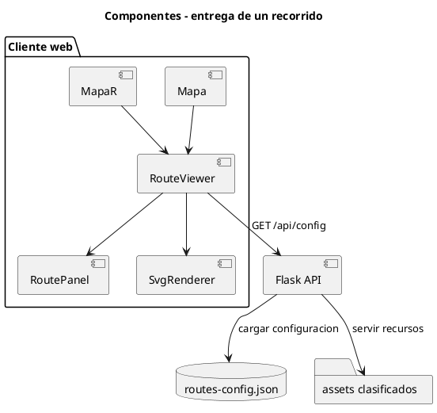

## 6. Diagrama de clases - configuracion persistente

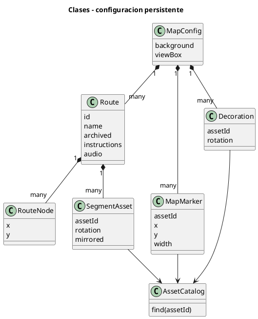

## 7. Secuencia - Mapa muestra una dependencia

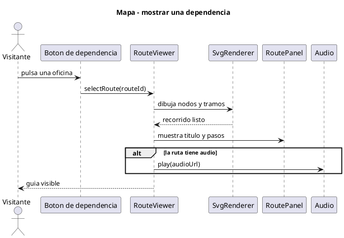

## 8. Secuencia - MapaR anima una ruta urbana

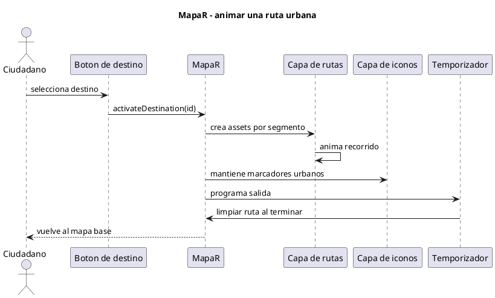

## 9. Secuencia - MapaConf guarda una ruta editada

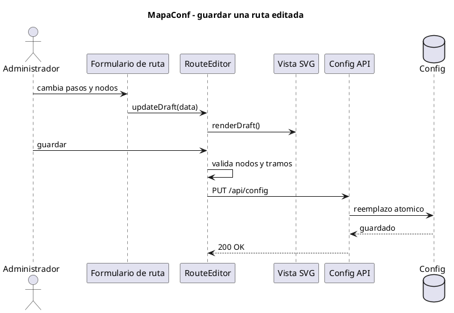

## 10. Secuencia - MapaRConf reemplaza un fondo

```plantuml
@startuml
title MapaRConf - reemplazar fondo
actor Administrador
participant "Selector de mapas" as Picker
participant "Upload API" as Upload
folder "uploads/maps" as Maps
participant RouteEditor
participant "Config API" as ConfigApi
Administrador -> Picker : elige archivo de mapa
Picker -> Upload : POST /api/upload/maps
Upload -> Maps : almacena archivo
Maps --> Upload : ruta publica
Upload --> Picker : assetId y src
Picker -> RouteEditor : setBackground(assetId)
RouteEditor -> ConfigApi : PUT /api/config
ConfigApi --> Administrador : fondo publicado
@enduml
```

## 11. Estados - ciclo de publicacion de una ruta

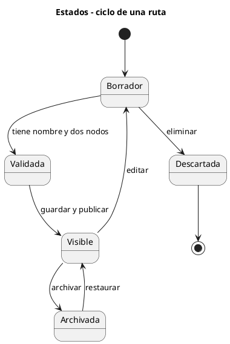

## 12. Estados - transformacion de un elemento visual

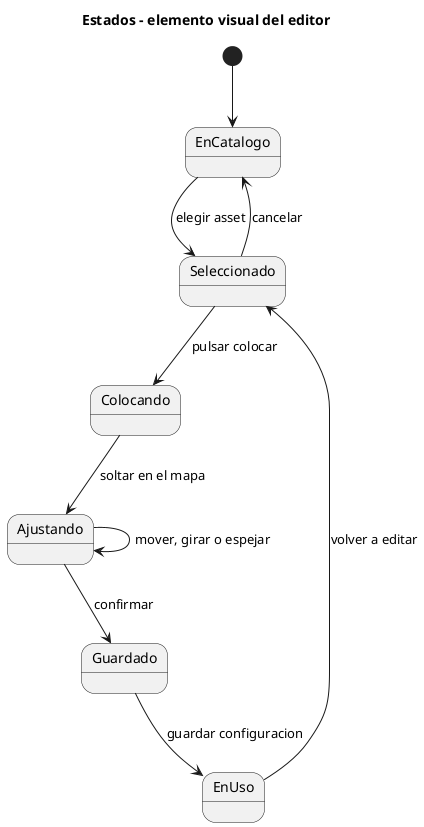

## 13. Estados - reproduccion de audio de una ruta

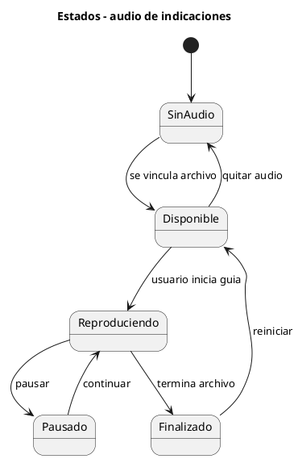

## 14. Actividad - consulta guiada dentro del terminal

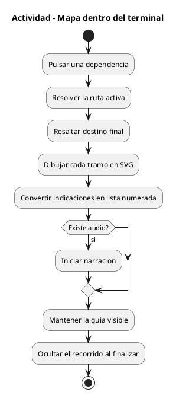

## 15. Actividad - recorrido urbano temporal

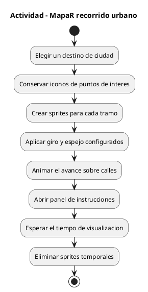

## 16. Actividad - construir una ruta desde MapaConf

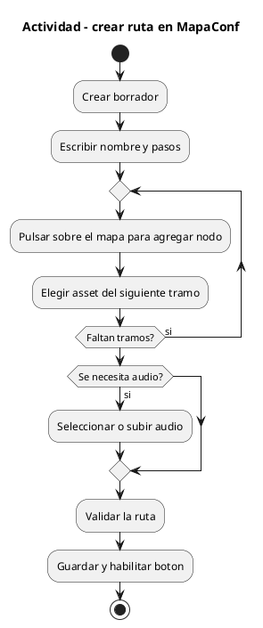

## 17. Actividad - personalizar el lienzo desde MapaRConf

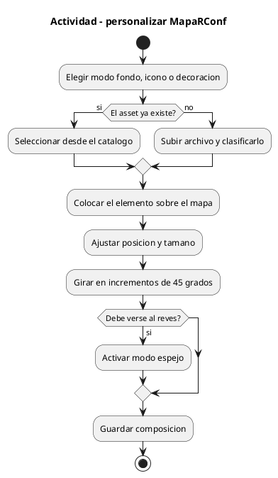

## 18. Colaboracion - objetos de una guia interna

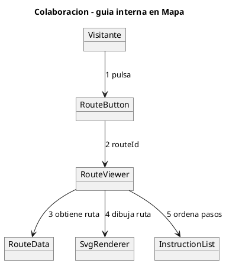

## 19. Colaboracion - objetos del editor de rutas

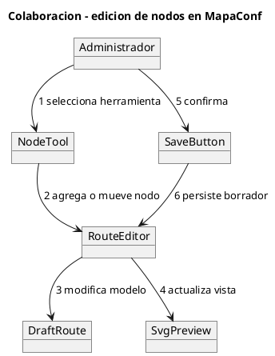

## 20. Colaboracion - objetos del catalogo visual

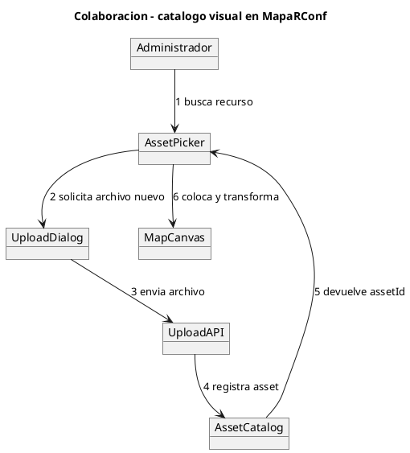
