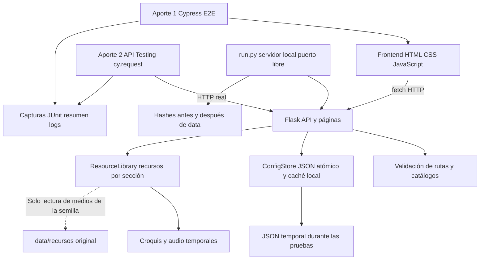
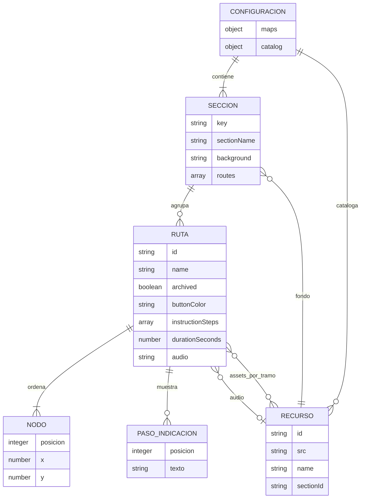
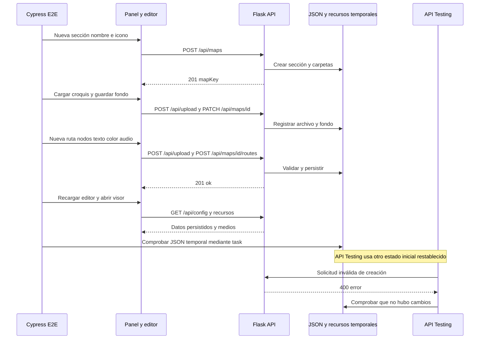

# Fuentes editables de los diagramas

Estos diagramas describen la versión local analizada para Seminario. Se pueden
editar como Mermaid y visualizar en GitHub o un editor compatible. El informe
PDF incluye representaciones equivalentes de arquitectura, datos y secuencia.

## Arquitectura y participación de los dos aportes

En uso habitual, ConfigStore apunta a data/routes-config.json. En estas pruebas
se inyecta otra instancia, con rutas temporales, mediante create_app. No hay
servicios cloud, base SQL, Redis ni proveedor externo en estos recorridos.

## Modelo de datos lógico

Es un modelo lógico de objetos y arreglos JSON, no tablas ni claves foráneas SQL.
Una ruta requiere al menos dos nodos; Mermaid no expresa ese mínimo exacto.
X admite 0..2000 e Y 0..1000. durationSeconds, si se envía, admite 3..3600.
Nombre de ruta no vacío; identificador único dentro del mapa al crear.
Las relaciones a recursos no implican una validación exhaustiva de referencias:
el servidor no comprueba toda asociación como lo haría una base relacional.

## Secuencia del proceso crítico

