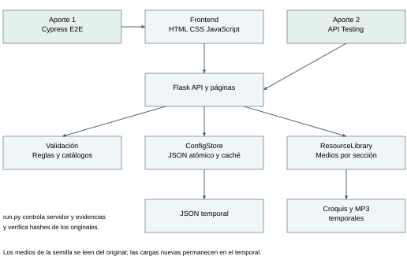
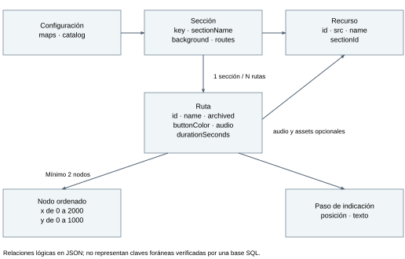
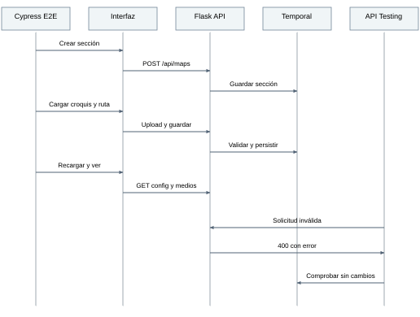
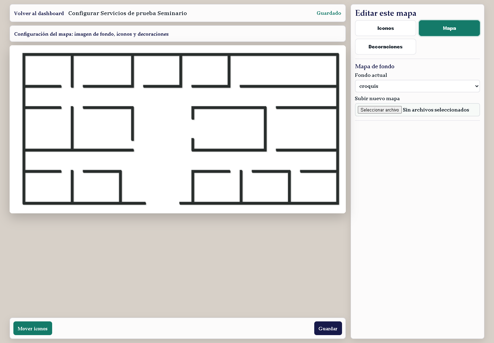
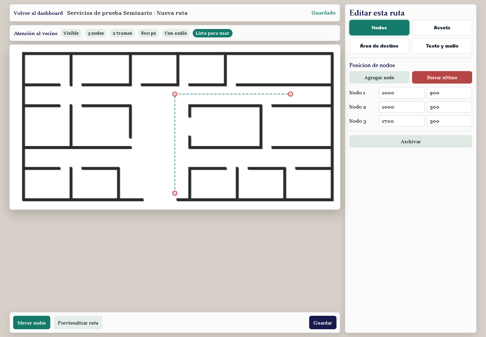
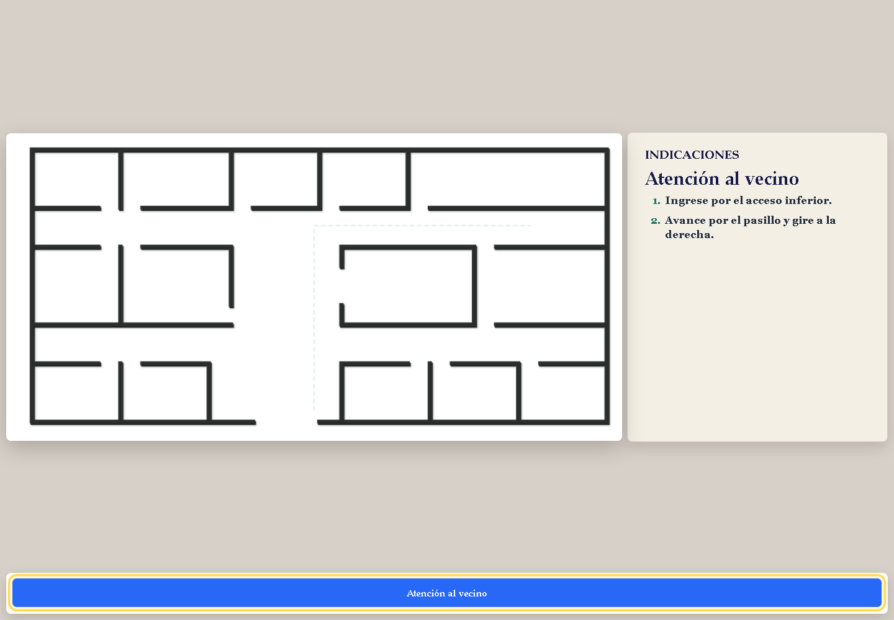
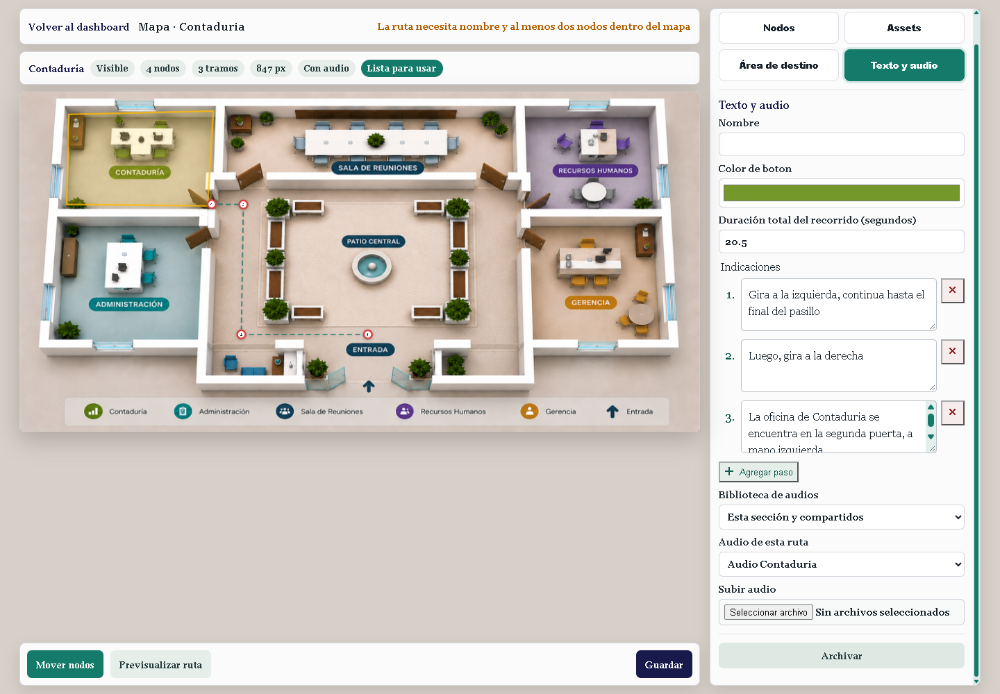

# Cypress E2E y API Testing para el sistema municipal de rutas

Informe técnico de Seminario de Tecnologías de Información. Fecha de verificación:
30 de octubre de 2026, zona America/Guatemala. Elaborado sin carátula por solicitud
del responsable del proyecto.

## 1 Problema y alcance de los aportes

El sistema de la Municipalidad de Retalhuleu permite orientar a visitantes mediante
mapas, rutas, indicaciones y audio. El personal administrativo configura secciones,
fondos y recorridos desde el panel. Una configuración incorrecta puede mostrar
indicaciones equivocadas o dejar datos distintos de los que el administrador creyó
guardar. La verificación debe observar la persistencia, no solamente un mensaje.

Se implementaron dos aportes: Cypress E2E para verificar la interacción real del
personal con la interfaz y API Testing para comprobar los contratos HTTP, sus
reglas y la conservación de los datos. Comparten la herramienta Cypress; son dos
enfoques con riesgos y evidencias distintos. No se presentan como pruebas unitarias.

El alcance comprende crear una sección, cargar un croquis como fondo, crear una
ruta con tres nodos, dos indicaciones, color, duración y audio, guardar, recargar
y consultar el visor público. API Testing comprueba además duplicados, objetivos
ausentes y entradas inválidas. No se implementaron funcionalidades nuevas del
producto ni se configuró CI o despliegue.

## 2 Estado previo y justificación

Ya existían Flask, el frontend modular, validaciones, ConfigStore y ResourceLibrary.
También había pruebas Python de API y persistencia y pruebas Selenium de interfaz.
El laboratorio BDD anterior estaba archivado. Por ello, no se atribuye a esta entrega
la creación de esas funcionalidades ni la primera automatización del proyecto.

La profundización consiste en una suite Cypress integrada y reproducible para el
flujo solicitado, pruebas HTTP reales independientes de la interfaz, comparación
exacta del MP3 enviado y recibido, comprobación del JSON temporal, evidencia JUnit,
capturas y un ensayo reproducible de detección de una regresión. API05 agrega la
comprobación explícita del límite de 80/81 caracteres del nombre de sección.

| Decisión | Alternativa considerada | Motivo de elección y costo |
| --- | --- | --- |
| Cypress E2E | Continuar exclusivamente con Selenium | Se eligió por la preferencia del responsable y sus esperas e interceptores integrados. Añade Node.js, Cypress y Chrome. |
| API Testing con cy.request | Colección Postman/Newman o cliente Flask | Comparte instalación con E2E y usa HTTP real sin simular respuestas. Se pierde la independencia de una herramienta dedicada de colecciones. |
| JSON temporal y create_app | Ejecutar contra la instancia habitual | Protege la configuración y los recursos municipales. Requiere un ejecutor que controle servidor, puerto y limpieza. |
| Cambios limitados a pruebas | Introducir GraphQL, Redis o cloud | Atiende los riesgos seleccionados sin ampliar la arquitectura de producción ni agregar infraestructura innecesaria. |

La mejora demostrada es verificabilidad reproducible de estos casos y capacidad
de detectar el defecto controlado. No se afirma mejora porcentual de calidad,
cobertura total o rendimiento, porque no se midieron esas magnitudes.

## 3 Requerimientos y restricciones

| ID | Requerimiento verificable | Evidencia |
| --- | --- | --- |
| R01 | Crear una sección desde el panel y guardar un fondo propio | E2E01 y captura del croquis |
| R02 | Persistir nombre, dos pasos, color, duración, nodos y audio | E2E01, recarga y JSON temporal |
| R03 | Mostrar el recorrido guardado al visitante | E2E01 y captura del visor |
| R04 | Rechazar un nombre vacío sin perder lo guardado | E2E02 y API03 |
| R05 | Aplicar contratos HTTP, límites y errores reales | API01 a API06 y JUnit |
| R06 | Conservar las otras rutas y mapas al editar | API02 |
| R07 | Evitar cambios en datos municipales y medios originales | integridad.json y limpieza del servidor |
| R08 | Demostrar que los controles detectan una regresión | API03 falla en el ensayo con defecto |

Se mantienen Python, Flask y el JSON existentes. Las ejecuciones son locales,
secuenciales y sin credenciales. El sistema no requiere iniciar sesión en el
panel actual; esta entrega no agrega autorización. Las pruebas de interfaz no
constituyen una revisión completa de seguridad, accesibilidad o dispositivos.

## 4 Arquitectura y responsabilidades



El frontend utiliza fetch para comunicarse con los endpoints. backend/api.py
aplica reglas de backend/validation.py, utiliza ConfigStore para persistencia
atómica y ResourceLibrary para archivos por sección. backend/pages.py entrega
las pantallas y los recursos. La arquitectura de producción no fue alterada.

run.py crea otra aplicación mediante create_app y le inyecta un ConfigStore con
una copia temporal de routes-config.default.json. Flask escucha en 127.0.0.1 y
un puerto libre. Cypress recibe esa URL. Los recursos recién cargados van al
directorio temporal; los medios de la semilla se leen del original cuando hace
falta mostrarlos. No se escriben en data/recursos original.

La configuración de Cypress exige las rutas proporcionadas por el ejecutor y
comprueba que el JSON esté en el directorio temporal. Antes de cada prueba,
reset restablece solamente ese archivo. Al terminar la ejecución se detiene
el servidor y se elimina su directorio temporal.

## 5 Modelo de datos y contrato HTTP



Se trata de un modelo lógico JSON, no de un esquema SQL. Configuración contiene
maps y catalog; cada sección agrupa rutas y un fondo. Una ruta ordena nodos y
pasos de indicación, y puede referenciar audio y assets por tramo. El catálogo
registra id, src, name y sectionId de cada recurso. Los fondos se guardan en la
biblioteca compartida Fondos y el audio cargado pertenece a la sección creada.

| Operación | Entrada relevante | Éxito | Error demostrado |
| --- | --- | --- | --- |
| POST /api/maps | name, icon, template | 201, ok y mapKey | 400 por nombre de 81 caracteres |
| POST /api/maps/{map}/routes | objeto route y catálogo opcional | 201, ok | 400 inválido; 404 mapa ausente; 409 ID duplicado |
| PATCH /api/maps/{map}/routes/{id} | route con ID coincidente | 200, ok | 404 ruta ausente; 400 nombre vacío en E2E |
| GET /api/config | Sin cuerpo | 200, maps y catalog | Se usa para comprobar lo persistido |
| POST /api/upload | multipart file, kind y mapKey | 201, recurso con src | 400 si falta archivo |
| PATCH /api/maps/{map} | objeto map con background | 200, ok | El E2E verifica persistencia del fondo |

Reglas comprobadas: nombre de ruta con contenido; al menos dos nodos; X entre
0 y 2000 e Y entre 0 y 1000, inclusive; booleanos no válidos como coordenadas;
duración enviada entre 3 y 3600 segundos; nombre de sección de hasta 80 caracteres.
Un ID duplicado genera conflicto: no se afirma que POST tenga clave de idempotencia.
El mensaje general de error de ruta no enumera todas las reglas de duración.

## 6 Secuencia e implementación del E2E



E2E01 pulsa Nueva sección, utiliza el mapa de oficinas como plantilla, carga el
croquis adjunto y guarda el fondo. Abre Nueva ruta, escribe Atención al vecino,
agrega dos pasos, configura color #2563eb y duración de 15 segundos, carga Audio
de prueba.mp3 y establece nodos (1000,900), (1000,300) y (1700,300). El tercer nodo
se crea haciendo clic sobre el SVG y sus coordenadas se ajustan con los campos.

La ruta se comprueba en el JSON temporal, al recargar el editor y en el visor.
Se comprueban el botón azul, las indicaciones, los elementos del recorrido y
la entrega exacta de los bytes del audio original. El trazo no certifica una
ruta física válida dentro de un edificio; es un recorrido demostrativo sobre
el croquis elegido por el responsable.

E2E02 abre una ruta de la semilla temporal, intenta guardar espacios como nombre,
comprueba HTTP 400 y el mensaje visible, verifica que no cambió el JSON, corrige
el nombre y confirma persistencia después de recargar.

Los interceptores solo observan el tráfico real. No se sustituyen respuestas
exitosas. Se usan esperas de Cypress sobre elementos y solicitudes, sin pausas
fijas. Para el control nativo de color se cambia el valor DOM y se dispara input,
sin modificar el modelo interno. Cypress sigue el enlace del editor en la misma
pestaña tras comprobar su target original; no verifica múltiples pestañas.

## 7 Escenarios de API Testing

| Caso | Comportamiento y riesgo comprobados |
| --- | --- |
| API01 | Crear con puntos en bordes inclusivos, comprobar contenido por GET y JSON, y rechazar un ID duplicado sin agregar otra ruta. |
| API02 | Editar nombre, indicaciones y color, comprobar lo persistido y conservar las otras rutas y el mapa urbano. |
| API03 | Rechazar seis variantes: nombre vacío, un nodo, X negativo, coordenada booleana y duración de 2 o 3601 segundos; sin escrituras. |
| API04 | Rechazar mapa y ruta ausentes con mensaje correcto, sin crearlos. |
| API05 | Aceptar nombre de sección de 80 caracteres y rechazar 81, conservando el estado previo al rechazo. |
| API06 | Rechazar carga sin archivo y catálogo con audios de tipo incorrecto; sin cambios en configuración. |

Cada caso se ejecuta contra HTTP real mediante cy.request y un estado inicial
restablecido. No depende del clic de un usuario. Se verifican cuerpos de respuesta,
mensajes y datos persistidos, además de estados HTTP. Los seis valores de API03
son variantes dentro de una prueba, no seis pruebas independientes.

## 8 Verificación y resultados reales

La verificación normal del 30 de octubre de 2026 aprobó **8 de 8 pruebas**:
2 E2E y 6 API, con cero fallidas, pendientes u omitidas. La ejecución final normal
inició a las 10:36:50 de Guatemala. Cypress informó aproximadamente 11 segundos
de ejecución de los escenarios, sin contar instalación y arranque del navegador.

Entorno: Windows, Python 3.13.14, Flask 3.0.3, Node.js 22.23.2,
Cypress 15.21.1 y Chrome headless 156.0.8078.74.

| Ejecución | Aprobadas | Fallidas | Pendientes u omitidas | Interpretación |
| --- | --- | --- | --- | --- |
| Normal | 8 | 0 | 0 | Comportamiento correcto de los dos aportes. |
| Defecto controlado, solo API | 5 | 1 | 0 | API03 detectó la aceptación incorrecta de nombre vacío. |

El ensayo final con defecto comenzó a las 10:39:03 de Guatemala. Ambas ejecuciones
confirmaron datos originales intactos y servidor detenido. Los JUnit coinciden
con los resúmenes JSON. No se cuentan las seis variantes de API03 como pruebas
separadas.


La ejecución con defecto controlado debilita exclusivamente en memoria la regla
del nombre, dentro del proceso temporal. No se edita backend/validation.py.
API03 espera HTTP 400 y detecta HTTP 201: el control falla correctamente ante
la regresión simulada. El código de salida es distinto de cero y la evidencia
se guarda aparte. Este fallo esperado no corresponde a un defecto encontrado
en el código normal de producción.

Durante la preparación se corrigió un problema del ejecutor: la consola Windows
cp1252 no representaba los caracteres de Cypress. Se estableció salida UTF-8.
También se ajustó el tamaño de la ventana headless para conservar capturas completas.
No se cambiaron reglas de la aplicación para obtener resultados aprobados.






Las capturas pertenecen al estado temporal de demostración. No son datos nuevos
publicados en el sistema municipal. integridad.json compara antes y después los
archivos y directorios de data y los medios de entrada. El resumen registra que
el servidor independiente fue detenido.

## 9 Reproducción y mapa de archivos

Las instrucciones completas están en tests/seminario/README.md. Instalar Flask
con requirements.txt y Cypress con npm ci dentro de tests/seminario. Ejecutar
desde la raíz con el Python de ese entorno:

```powershell
tests/seminario/.venv/Scripts/python.exe tests/seminario/run.py
tests/seminario/.venv/Scripts/python.exe tests/seminario/run.py --aporte e2e
tests/seminario/.venv/Scripts/python.exe tests/seminario/run.py --aporte api
```

Para la demostración de detección añadir --defecto-controlado al comando del
aporte api. Repetir el comando normal inicia otro proceso con las reglas correctas.
No se requiere iniciar el servidor habitual, Docker ni recuperar BDD.

| Archivo o carpeta | Responsabilidad |
| --- | --- |
| tests/seminario/e2e.cy.js | Dos escenarios de interfaz, con funciones y pasos comentados. |
| tests/seminario/api.cy.js | Seis escenarios de contratos HTTP y persistencia. |
| tests/seminario/run.py | Servidor, aislamiento, ejecución, defecto controlado e integridad. |
| tests/seminario/cypress.config.js | Chrome, tareas, JUnit, capturas y resumen. |
| package.json y package-lock.json | Versión fijada de Cypress y dependencias Node. |
| requirements.txt y .env.example | Dependencias Python y variables sin secretos. |
| fixtures/croquis.png | Copia del croquis adjunto utilizado en el E2E. |
| documentacion/seminario/evidencias | Selección reproducible de resultados y capturas. |
| diagramas.md | Fuentes Mermaid editables de los tres diagramas. |
| guion-demostracion.md | Secuencia para exponer y preguntas técnicas. |
| VERSION.json | Commit base, hashes de los archivos relevantes e identificación del paquete. |

Se actualizó únicamente la documentación general README para enlazar estos
aportes. No se modificaron backend, frontend, configuración municipal ni otras
pruebas para implementar esta suite.

## 10 Limitaciones y preparación de entrega

El audio se carga y entrega correctamente, pero no se certifica audición humana,
calidad acústica, compatibilidad de todos los códecs o políticas de reproducción
en todos los equipos. El E2E no comprueba pestañas múltiples, móviles ni todos los
recorridos administrativos. No es una auditoría de seguridad ni una prueba de carga.
El backend valida extensiones de carga, no la autenticidad de todo archivo multimedia.

La suite usa una versión fijada de Cypress, el Chrome instalado y datos temporales.
La disponibilidad de Internet se necesita al instalar dependencias por primera vez.
El archivo .env.example documenta variables del proceso y no se carga automáticamente.
La aplicación mantiene las responsabilidades y limitaciones de persistencia JSON.

La rúbrica pide código fuente en GitHub y una versión identificada por commit o
etiqueta. El remoto configurado es https://github.com/jefroMMM/PG1-Muni. Esta tarea
no hizo commit ni push; el commit base no incluye por sí solo esta entrega ni los
otros cambios locales previos. Antes de entregar, revisar los archivos necesarios,
registrar una versión autorizada y comprobar que el enlace permita reproducirla.
VERSION.json identifica el contenido local mediante hashes, pero no sustituye ese paso.

No se crea carátula por petición del responsable. La identificación del equipo y
las contribuciones reales de cada integrante deben añadirse al documento final
por quienes presentan el proyecto; no se inventan nombres ni atribuciones.

| Criterio de rúbrica | Dónde se atiende |
| --- | --- |
| Análisis y justificación, 4 puntos | Secciones 1 a 3 y comparación de alternativas. |
| Diseño y diagramas, 4 puntos | Secciones 4 a 6 y diagramas.md. |
| Primer aporte, 6 puntos | E2E01, E2E02, capturas y código comentado. |
| Segundo aporte, 6 puntos | API01 a API06, solicitudes reales y JUnit. |
| Verificación y resultados, 4 puntos | Ejecución normal, defecto controlado e integridad. |
| Reproducibilidad, 3 puntos | README, dependencias, .env.example, hashes; publicación pendiente. |
| Presentación y dominio, 3 puntos | guion-demostracion.md; la exposición corresponde al equipo. |

## 11 Referencias y enlaces

Rúbrica suministrada: rubrica.docx, consultada el 30 de octubre de 2026.
Repositorio configurado: https://github.com/jefroMMM/PG1-Muni.
Evidencias locales: evidencias/normal y evidencias/defecto-controlado, junto a este informe.

- API Testing con Cypress: https://docs.cypress.io/app/guides/api-testing
- Solicitudes HTTP: https://docs.cypress.io/api/commands/request
- Intercepción y observación: https://docs.cypress.io/api/commands/intercept
- Carga de archivos: https://docs.cypress.io/api/commands/selectfile
- Pruebas de Flask: https://flask.palletsprojects.com/en/stable/testing/

Estos enlaces documentan las herramientas; los resultados de esta entrega
provienen de sus reportes locales y no de ejemplos de terceros.
